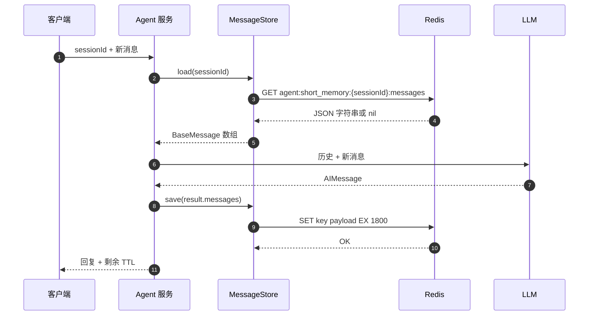
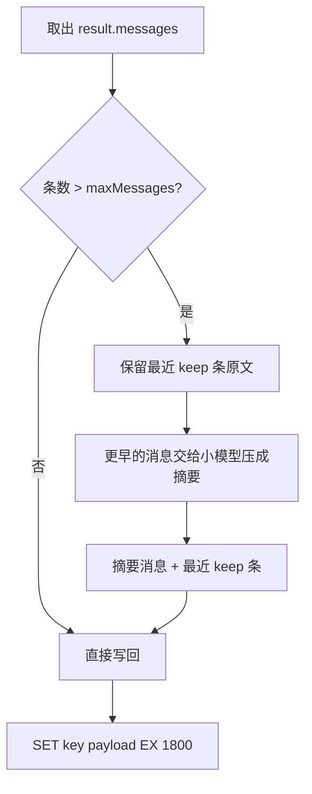

Agent 丢上下文，多数时候不是模型的问题，而是记忆层把三类状态混进了同一个 key：会话消息、会话元信息、跨会话画像。Redis 只该接前两类，第三类去向量库或 PostgreSQL。混着存，上线后通常先撞两个错：`message._getType is not a function` 和 `WRONGTYPE Operation against a key holding the wrong kind of value`。

这篇拆四件事：一轮对话的存取闭环、Store 该封到什么粒度、消息对象与 JSON 之间的边界、以及同一 session 并发写时怎么不丢消息。

## 一轮对话的四个动作

一次 `invoke` 前后，记忆层只做四步：读、拼、写、查 TTL。



顺序不能反：历史在前，新消息在后。顺序错了，模型会把新问题理解成“用户先说了这句话，隔了几轮才回答”。

写回的是 `result.messages`，不是你传进去的数组。模型回复、工具调用记录、压缩后生成的摘要，全在 `result.messages` 里。只写回入参，下一轮就丢了这一轮的答案，表现是“记得很多，唯独忘了刚说过的话”。

## 客户端与 Store：把 Redis 命令收进一个边界

直接在各处写 `redis.get()`，key 规则会散在十几个文件里，换前缀要改一遍，出错也没法统一降级。先收成单例客户端，再包一个仓储类。

```js
// Node 18+ / ioredis 5.x
import Redis from 'ioredis'

export const redis = new Redis({
  host: process.env.REDIS_HOST ?? '127.0.0.1',
  port: Number(process.env.REDIS_PORT ?? 6379),
  password: process.env.REDIS_PASSWORD || undefined,
  db: 0,
  maxRetriesPerRequest: 3,
  enableReadyCheck: true,
})

redis.on('error', (err) => {
  // 必须监听：未处理的 error 事件会让 Node 进程直接退出
  console.error('[redis] connection error', err)
})
```

四个容易忽略的点：

- `new Redis()` 立即建连，不是 lazy。构造函数执行完连接就在建立，容器启动顺序没排好会先报一轮连接拒绝。
- `password` 只在服务端配了 `requirepass` 时传。没配还传，报 `ERR AUTH called without any password configured`。
- `db` 是逻辑库，不是隔离手段。Redis Cluster 只支持 db 0，靠 db 分环境的代码迁移时会痛。
- 进程退出前调用 `quit()`，它等队列里的命令执行完再断；`disconnect()` 是立刻断。少了这一步，脚本跑完终端会卡住，因为连接是活跃句柄。

Store 只暴露三个方法，对应三条命令：

```js
import { HumanMessage, AIMessage, SystemMessage, ToolMessage } from '@langchain/core/messages'

const MESSAGE_CTOR = {
  human: HumanMessage,
  ai: AIMessage,
  system: SystemMessage,
  tool: ToolMessage,
}

function toStored(messages) {
  return messages.map((m) => {
    const type = m._getType()
    const data = { content: m.content }
    if (m.additional_kwargs && Object.keys(m.additional_kwargs).length) {
      data.additional_kwargs = m.additional_kwargs
    }
    if (m.tool_calls?.length) data.tool_calls = m.tool_calls
    if (m.tool_call_id) data.tool_call_id = m.tool_call_id
    if (m.name) data.name = m.name
    if (m.id) data.id = m.id
    return { type, data }
  })
}

function fromStored(stored) {
  return stored.map(({ type, data }) => {
    if (type === 'tool') {
      return new ToolMessage(data)
    }
    const Ctor = MESSAGE_CTOR[type]
    if (!Ctor) throw new Error(`unknown message type: ${type}`)
    return new Ctor(data)
  })
}

export class RedisMessageStore {
  #redis
  #prefix
  #ttlSeconds

  constructor({ redis, prefix = 'agent:short_memory:', ttlSeconds = 1800 }) {
    this.#redis = redis
    this.#prefix = prefix
    this.#ttlSeconds = ttlSeconds
  }

  #key(sessionId) {
    return `${this.#prefix}{${sessionId}}:messages`
  }

  async load(sessionId) {
    const raw = await this.#redis.get(this.#key(sessionId))
    if (raw === null) return []
    return fromStored(JSON.parse(raw))
  }

  async save(sessionId, messages) {
    const payload = JSON.stringify(toStored(messages))
    await this.#redis.set(this.#key(sessionId), payload, 'EX', this.#ttlSeconds)
  }

  async ttl(sessionId) {
    return this.#redis.ttl(this.#key(sessionId))
  }
}
```

`set` 的参数是位置参数，对应原生命令 `SET key value EX 1800`，不要写成 `{ ex: 1800 }`。`ttl` 返回 `-1` 表示 key 存在但没设过期，`-2` 表示 key 不存在。本设计每次 `save` 都带 `EX`，`-1` 正常不会出现，排查手工写入的数据时才有用。

每次 `save` 都重新计 1800 秒，活跃会话永不过期，闲置半小时自动清理。这就是滑动窗口，不需要额外的定时任务。

## 消息对象和 JSON 之间必须有一层映射

`HumanMessage` 是类实例，`_getType()`、`concat()` 挂在原型上。从 Redis 读回来 `JSON.parse` 得到的是普通对象，原型链上没有这些方法，LangChain 内部一调 `_getType()` 就炸。

也别指望 `JSON.stringify(message)` 直接存：LangChain 的 `BaseMessage` 自带 `toJSON()`，输出的是 `{"lc":1,"type":"constructor","id":["langchain_core","messages","HumanMessage"],"kwargs":{...}}`，`content` 埋在 `kwargs` 里，读回来还得自己拆。显式映射成 `{ type, data }` 更稳，格式也由自己控制。

所以边界只有两个方向：出站压成 `{ type, data }` 纯数据，入站 `new` 回对应类。常见 `type` 是 `human`、`ai`、`system`、`tool` 四种，整体必须是数组；旧式 `FunctionMessage` 的 `_getType()` 返回 `function`，遇到就补进映射表，否则 `fromStored` 会抛 `unknown message type`。手写测试数据往 Redis 里塞单条对象，读回来 `stored.map` 直接报 `is not a function`。

工具调用是这条边界上最容易漏的字段。`AIMessage` 的 `tool_calls` 和 `ToolMessage` 的 `tool_call_id` 不一起存，恢复出来的对话在下一轮会让模型重复调工具，或者干脆丢掉工具结果。上面的映射把这两个字段单独处理，就是为了避免这个问题。

String 还是 List？这是个真实的取舍：

| 方案 | 适合 | 代价 |
| --- | --- | --- |
| String 存整个 JSON 数组 | 会话短、消息少（几十条内） | 每轮全量覆盖写，O(n) 写放大 |
| Hash 每字段一条消息 | 需要单条更新、消息较多 | 要维护自增序号和裁剪逻辑 |
| Streams `XADD` + `MAXLEN` | 长会话、要按时间回放 | 读时要重建数组，还要处理压缩 |

几十条消息的客服会话，String 最简单：一次 `GET`、一次 `SET`，没有下标管理。消息到几百条、每轮全量 `JSON.stringify` 开始拖慢 P99 时，再换 Streams 不迟——`XADD ... MAXLEN ~ 200` 天然带裁剪，比手写 List 裁剪可靠。

## 压缩：Redis 负责不丢，中间件负责不爆

TTL 只解决“存多久”，不解决“存多长”。历史线性增长，最终一定顶到上下文窗口，token 成本也跟着线性涨。压缩策略不依赖框架，逻辑就三步：攒够阈值、保留最近若干条、把更早的对话压成一段摘要。



```js
import { HumanMessage, SystemMessage } from '@langchain/core/messages'

async function compressIfNeeded(messages, summaryModel, { maxMessages = 8, keep = 4 } = {}) {
  if (messages.length <= maxMessages) return messages

  const older = messages.slice(0, -keep)
  const recent = messages.slice(-keep)
  const transcript = older
    .map((m) => `${m._getType()}: ${typeof m.content === 'string' ? m.content : JSON.stringify(m.content)}`)
    .join('\n')

  const summary = await summaryModel.invoke([
    new SystemMessage('把下面的对话压缩成要点，保留事实、数字、承诺和未完成事项，不要评论。'),
    new HumanMessage(transcript),
  ])

  return [new SystemMessage(`更早对话的摘要：\n${summary.content}`), ...recent]
}
```

算一笔账：每条消息平均 150 token，40 轮大约 80 条消息，不压缩时每轮要带 12000 token。压缩后是“200 token 摘要 + 最近 4 条 600 token”，约 800 token，压到原来的 1/15，延迟和费用一起下来。

两个细节决定这套策略是否可靠：

1. **摘要消息用 `SystemMessage`，排在消息数组最前面**。`createAgent`（`langchain` v1）的 `systemPrompt` 由框架单独注入，不会被数组里的消息覆盖；如果你手动拼 prompt，就要把摘要排在 system prompt 之后，别把行为约束挤掉。
2. **压缩结果要写回 Redis**，不能只在内存里压一次。下一轮从 Redis 读到的必须是“摘要 + 最近 4 条”，否则每轮都从全量历史重新压，成本反而更高。生产上再加一条：数组首条已经是摘要时，先把它取出来和新摘要合并，别当普通消息再压一遍，否则隔几轮细节就被磨没了。

`keep` 别设太小。保留最近 2 条时，模型经常看不到上一轮的工具结果，出现“刚查完又问一遍”的循环。4 条是个稳妥起点，按业务再调。

## 并发写才是真正的坑

Redis 单条命令原子，但“读—改—写”不是。两个请求同时打到同一 session：A 读、B 读、A 写、B 写，A 的回复被 B 的覆盖。用户看到的现象是“我明明说了两句话，它只回了一句”。

单实例部署可以用进程内队列按 sessionId 串行化；多实例就必须落到 Redis 上。最小可用的是 per-session 锁：

```js
import { randomUUID } from 'node:crypto'

const RELEASE = `if redis.call('get', KEYS[1]) == ARGV[1] then
  return redis.call('del', KEYS[1])
else
  return 0
end`

const sleep = (ms) => new Promise((r) => setTimeout(r, ms))

export class SessionLock {
  #redis
  #ttlMs
  #waitMs

  constructor(redis, { ttlMs = 15000, waitMs = 3000 } = {}) {
    this.#redis = redis
    this.#ttlMs = ttlMs
    this.#waitMs = waitMs
  }

  async run(sessionId, fn) {
    const key = `agent:lock:{${sessionId}}`
    const token = randomUUID()
    const deadline = Date.now() + this.#waitMs

    let acquired = false
    while (!acquired && Date.now() <= deadline) {
      acquired = (await this.#redis.set(key, token, 'PX', this.#ttlMs, 'NX')) === 'OK'
      if (!acquired) await sleep(50 + Math.floor(Math.random() * 50))
    }
    if (!acquired) throw new Error(`session busy: ${sessionId}`)

    try {
      return await fn()
    } finally {
      // 只删自己持有的锁，避免误删别人的
      await this.#redis.eval(RELEASE, 1, key, token)
    }
  }
}
```

锁的 `ttlMs` 要大于一次完整 `invoke` 的耗时。LLM 调用慢的时候，锁先过期，第二个请求照样进来。要么按 P99 设置并加续期，要么退一步接受乐观并发：写回前检查版本号，冲突就重试整轮。

另外两种方案也成立：

- `WATCH` + `MULTI`：读的时候 watch 消息 key，写回时 `exec()`，被改过就返回 `null`，重读重试。适合冲突少的场景，不用管理锁的生命周期。
- Streams 追加：`XADD` 本身就是追加，不覆盖，天然没有丢更新问题。代价是读的时候要重建数组，且压缩要额外处理。

锁的 key 和消息 key 共用 `{sessionId}` 这个 hash tag，Redis Cluster 下会落在同一个 slot，`MULTI` 才合法。这也是 key 里带花括号的唯一原因——它不是模板语法，是 hash tag。

## key 设计与排查

推荐的 key 结构：

```text
agent:short_memory:{sessionId}:messages   String，JSON 消息数组
agent:short_memory:{sessionId}:meta       Hash，用户信息、轮次、创建时间
agent:long_memory:{userId}                长期记忆，实际走向量库
```

前缀按 `业务:存储类型:维度:id` 分层，`redis-cli --scan --pattern 'agent:short_memory:*'` 能一次捞全。不要用 db 做隔离，理由前面说过。

排查清单：

| 现象 | 常见原因 |
| --- | --- |
| `WRONGTYPE` | 用 String 命令操作 Hash/List 类型的 key |
| `TTL` 返回 `-2` | key 已过期，或写入时就没成功 |
| `_getType is not a function` | 少了 `fromStored`，直接用了 `JSON.parse` 的结果 |
| 摘要不生效 | 压缩结果没写回 Redis，或 `keep` 太小 |
| 脚本跑完不退 | 忘了 `redis.quit()` |
| 数据莫名消失 | 设了很短的 `EX`，或误执行 `FLUSHDB` |

排查用 `SCAN`，不要用 `KEYS`。`KEYS` 会阻塞整个 Redis 实例，生产环境一条命令就能把延迟打满。

## 结论

会话只活几十分钟、消息在百条以内，String 快照加 `SET EX` 就够用，别急着上向量库。真正该先做的三件事是：把消息映射收进 Store、给写回加锁或版本检查、把压缩结果持久化回 Redis。

下一步动作很具体：拿 `redis-cli --scan --pattern 'agent:short_memory:*'` 扫一遍线上 key，统计没有 TTL 的 key 有多少。没有 TTL 的会话数据会在 Redis 里无声堆积，等内存告警时再查，代价比现在高得多。
