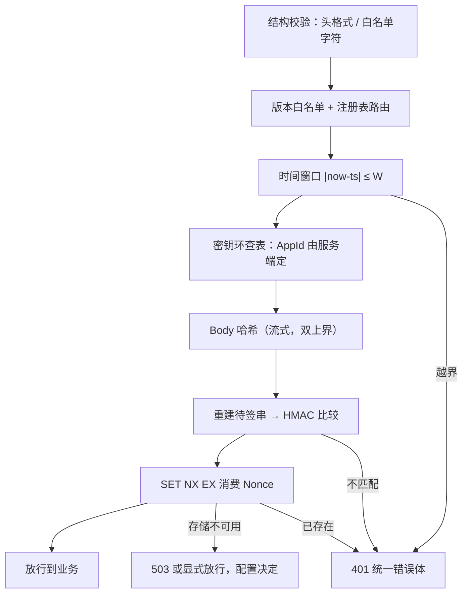

我先把 Nonce 的 TTL 配成和时间窗口一样的 300 秒，理由是「请求最多活 300 秒，那 nonce 也记 300 秒，正好对上」。这个推导看着闭合，跑出来却漏了一秒。

掘金上那篇[《API 安全三支柱：认证、防篡改、防重放的工程实践》](https://juejin.cn/post/7705196591631597595)给了七章的量，实现是 .NET。我按它的论断在 Go 里写了一份最小实现，把能验的都验了一遍：`TTL = 2W + δ` 成立，`%0A` 那条成立，恒定时间比较这条我在本机**没能测出它宣称的效果**。三处结果分开讲。

## 最小实现只有三样东西

签名的作用不是加密，是把「哪一段字节被承诺过」写清楚。剥到最小：

```go
const secret = "demo-secret-32-bytes-long-aaaaaaaa"

func sign(s string) string {
	m := hmac.New(sha256.New, []byte(secret))
	m.Write([]byte(s))
	return hex.EncodeToString(m.Sum(nil))
}

// 待签串：v1 / METHOD / path / query / bodyHash / keyId / ts / nonce
func sts(method, path, query, bodyHash, keyID, ts, nonce string) string {
	return strings.Join([]string{"v1", method, path, query, bodyHash, keyID, ts, nonce}, "\n")
}
```

篡改这一项立刻能验：

```text
合法请求验签通过：true
amount 改 99999 后验签通过：false
只往 query 塞一个 vip=1 后验签通过：false
```

第三行值得停一下。很多人签 Body 就以为完事了，`?src=app` 后面多一个 `&vip=1`，Body 一个字节没动，照样算出合法签名——权限开关常挂在 query 上，因为它比 Body 便宜。参与签名的字段清单本身就是协议，不是实现细节。

## 那一秒缝隙从哪来

`W` 是时间窗口，`δ` 是允许的时钟偏差。一条报文在服务端「还可能被重放」的总时长不是 `W`，是 `W + δ`：客户端时钟可以偏快 `δ`，它签出的时间戳到服务端还能多活 `δ`。Nonce 记录必须覆盖到这个点再加上回溯，即 `2W + δ`。

原文只给了公式。我写了个逐秒扫的循环，`W=300s`、`δ=60s`，从首发后第 1 秒一直重放到 `W+δ`：

```text
窗口 W=5m0s，容差 δ=1m0s → 一条报文最长可在服务端存活 6m0s
  TTL=30s    缝隙 +30s..+340s 的重放被放行（311s 条）
  TTL=1m0s   缝隙 +60s..+304s 的重放被放行（245s 条）
  TTL=5m0s   缝隙 +300s..+300s 的重放被放行（1s 条）
  TTL=6m0s   窗口内 360s 全部拦下
  TTL=11m0s  窗口内 360s 全部拦下
```

前四行是我原本以为安全的配法。`TTL = 30s` 那行最阴：它比窗口短得多，结果反而是缝隙最大的一档（311 秒可重放），因为 nonce 早早就被清掉，而窗口还在放行。`TTL = W` 那行只漏一秒——第 300 秒 nonce 恰好过期、时间戳恰好还在窗口内。

一秒在生产上是什么概念？重放不需要人守，一个 `for` 循环每秒打一次，必然命中那一格。金额、退款、扣库存这类接口被多执行一次，之后所有对账都要人工回滚。

所以我给这条加了启动即失败校验，而不是写进文档：

```go
if opt.NonceTTL < 2*opt.Window + opt.ClockSkew {
	log.Fatalf("nonce TTL %s < 2W+δ %s", opt.NonceTTL, 2*opt.Window+opt.ClockSkew)
}
```

配置错的后果不是慢一点，是全站 401 或者静默失去防重放。这种不变量只有进程起不来才能被保证。

## `%0A` 比 TTL 更容易被忽略

「字段之间用 `\n` 连起来就不会有歧义」——原文专门辟了一节否掉这句话，我也照做实验。构造两个不同的请求：

```text
A: RawTarget="/a%0Ab?c=1"  Path含换行=true   RawQuery="c=1"
B: RawTarget="/a?b%0Ac=1"  Path含换行=false  RawQuery="b%0Ac=1"
```

如果待签串用的是解码后的 `URL.Path`：

```text
两个完全不同的 URL，待签串是否相同：true
签名是否相同：true（相同即 A 的合法签名可被拿去签 B）
串行数：声明 8 行，A 实际 9 行，B 实际 9 行
```

A 的合法签名直接可以签 B。声明八行的串变成九行，多出来的那行是攻击者塞的分隔符，后面的字段整体错位一格。这不是理论：只要签名校验通过就当作「同一个请求」，跨接口、跨租户的越权都能从这个错位里长出来。

Go 里修法很具体：`RawPath` 在这个例子里是空字符串，因为 `%0A` 解码后正好是合法 path，Go 认为不需要单独保留原始串。所以：

```go
path := u.EscapedPath() // "/a%0Ab"，保住了编码
```

拿 `RawTarget` 或 `EscapedPath()`，别拿 `Path`。服务端框架同理，ASP.NET Core 是 `IHttpRequestFeature.RawTarget`。反过来按字段名去清洗用户输入更糟：清洗后的字节已经不是发出去的字节，签名不再承诺「收到的就是发出的」。

## 恒定时间比较：这条我没复现出来

原文强调比较签名要用 `CryptographicOperations.FixedTimeEquals`，理由是 hex 字符串短路比较会泄露前缀。我按同一口径量了 500 万次：

```text
Equal: 末字节不同               104.99ms  (matched=0)
Equal: 首字节不同               102.49ms  (matched=0)
字符串==: 末字节不同               21.73ms  (matched=0)
字符串==: 首字节不同               21.72ms  (matched=0)
```

`hmac.Equal` 确实恒定——末字节和首字节不同的差值 2.5ms，落在噪声里。但 `==` 在这台 aarch64 容器上两种位置也没差：64 个字符定长，Go 的字符串比较走 SIMD memcmp，第一个字节不同并不比最后一个字节快回来。也就是说，**我没能在这个规模上测出时间侧信道**，要测出它得把每次比较放进真实网络抖动的分布里反复统计，我没做。

结论打折但仍照做：`hmac.Equal` 是免费的，没有理由用 `==`；而原文那句「比较对象是解码后的 32 字节而不是 hex 串」有个独立于侧信道的理由——比较 hex 串时你还要先保证它是合法小写十六进制，否则长度不一的畸形输入会走进另一条分支。格式白名单先过，再解码，再定长比较。

## 顺序：唯一一次带副作用的写放最后



排序原则只有一条：失败成本递增，有副作用的写排在最后。Nonce 那次写入是唯一会让服务端状态变动的动作，放在验签之前，匿名流量就能拿随机 nonce 灌爆 Redis。

Redis 侧还有两个细节，原文用 C# 写的，我按 `go-redis` 对齐：`SetArgs{Mode: redis.SetNX, TTL: ...}` 一条命令完成「判断+写入」，先 `EXISTS` 再 `SET` 的写法在两步之间会被并发插队，两次都读到不存在、两条都放行。以及读从库会因复制延迟放过本该拦的重放——这一条我只在文档层面确认，本机单实例 Redis 复现不出来，属于留给有集群环境的读者的坑。

档位也不能由客户端声明。`X-Key-Id` 是客户端给的，一旦用它做早退判断（「这个 Key 不校验」），伪造一个 KeyId 就绕过验签。放行/严格两档的裁决只能来自服务端可信信号：路径前缀、端点元数据、全局开关；KeyId 查表命中后只允许把档位**收紧**。

## 两端对齐比算法难

真正花我时间的是取值口径，不是 HMAC：

- `Content-Type` 归一。客户端发 `application/json`，网关补成 `application/json; charset=utf-8`，两端都按「取 `;` 前 + Trim + 小写」归一才算一致：

  ```text
  客户端发 "application/json"                        -> "application/json"
  中间件补成 "application/json; charset=utf-8"       -> "application/json"
  ```

  缺失时要么两端都补空串，要么两端都不补。一端补另一端不补，就是永远对不上：

  ```text
  但另一端不补 -> ""，两者 false
  ```

- 重试必须换 Nonce、保留幂等键。同一份报文重发一次，自己把自己判成重放。幂等键保证同一业务意图不执行第二次的，Nonce 保证同一份字节不被用第二次的，两者不能合并成一个头。
- HTTP/2 没有 `Host` 头，只有伪头 `:authority`。签 `uri.Authority` 的规范化结果，按头名取值的实现升到 h2 就断。
- 时钟回拨。`now` 跳回过去会让已生效密钥判成未生效、把一批正常请求判成越界。经过时间用单调时钟度量，墙上时钟只用来和客户端对齐窗口；客户端拿服务端回写的 `X-Server-Time` 校准，容器里这点尤其重要。

## 剩下的

对称 HMAC 双方都能造出同一个签名，所以它给不了不可否认性；移动 App 和浏览器持有共享 Secret 必然被逆向，那两种场景该走 DPoP 或非对称。我这份实现只覆盖服务端到服务端。

下一步想试的是响应签名：`status + bodyHash + timestamp + 独立响应 nonce`，请求 nonce 只用于关联，不能当响应新鲜性的依据——这条我还没写代码。

要自己复现上面三组数字，跑这个就够：

```bash
go run main.go   # 待签串用 EscapedPath()，别用 Path
```
