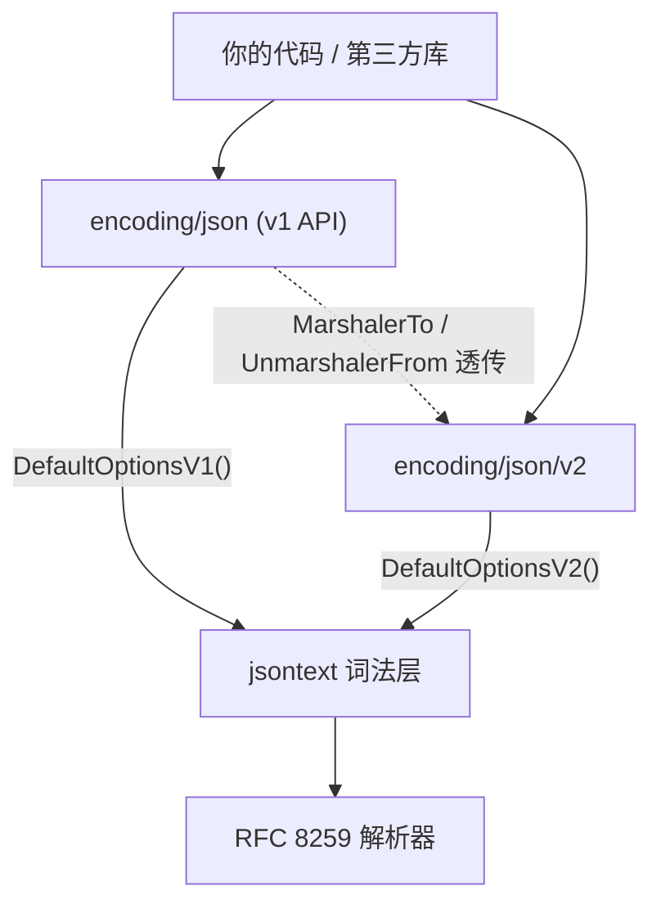

```
jsontext: duplicate object member name "name"
```

这是 Go 1.27 里 `encoding/json/v2` 对 `{"name":"li","age":30,"name":"wang"}` 的默认反应。同一份输入，你项目里的 `encoding/json` 到现在依然照单全收，字段拿最后一个值，`err` 是 `nil`。

十一月四日 Go 官方发了那篇 [A new Go API for JSON](https://go.dev/blog/jsonv2)，隔了六年才把这件事做完。文章有二十多段，我照着它把本机能跑的都跑了一遍，其中有几处结果和宣传口径不太一样——值得单独拿出来讲。

## 那条报错从哪来

v1 的问题清单官方列了很长，但真正会立刻咬到人的只有三项，因为它们改的是**默认值**，不是新增选项：

- 重复键：v1 静默取后一个，v2 直接报错。RFC 8259 没规定重复键该怎么办，于是不同实现可以各自解释，[CVE-2017-12635](https://nvd.nist.gov/vuln/detail/CVE-2017-12635) 就是拿这个做的提权。
- 非法 UTF-8：v1 把 `\xff\xfe` 原样接进字符串，v2 报 `invalid UTF-8 within "/name" after offset 9`。
- nil 切片与 map：v1 序列化成 `null`，v2 序列化成 `[]` 和 `{}`。

第三项最容易被当成小事，但它恰好是跨语言接口最常见的哑火点——很多别的语言在 `null` 上反序列化进数组字段时会直接失败。

我把这六项行为在同一台机器上并排跑了一遍（Go 1.27.0，aarch64，8 核）：

| 输入 / 操作 | v1 结果 | v2 结果 |
|---|---|---|
| 重复键 `{"name":"a","name":"b"}` | `nil`，name=`"b"` | `duplicate object member name` |
| 非法 UTF-8 | `nil`，name 里带乱码 | `invalid UTF-8 within "/name"` |
| `Marshal(User{Name:"a"})` 的 nil 切片 | `"tags":null` | `"tags":[]` |
| `{"NAME":"x","Tags":["t"]}` | 大小写不敏感，两个字段都进 | 严格匹配，**两个都丢** |
| `Decoder.Decode` 后跟第二个 JSON | 静默忽略 | `Unmarshal` 报 trailing 错误 |
| `time.Duration` 90s | `90000000000` | 报错，无默认表示 |

最后一行那个 90 秒变成 `90000000000` 是 v1 的老毛病：纳秒整数直接裸露给对端，换个语言读就完全是另一个数。v2 的处理是**拒绝猜**，把决定权交回给你。

## 大小写的坑比想象中深

上面表格里第四行值得单独停一下。v1 的大小写不敏感匹配导致 `{"NAME":"x","Tags":["t"]}` 两个字段都能落进结构体，而 v2 的严格匹配让它们**静默消失**——注意，不是报错，是变成零值。这类"编译过、测试过、上线后字段全空"的问题最难查。

要退回旧行为得显式开启：

```go
jsonv2.Unmarshal(data, &u, jsonv2.MatchCaseInsensitiveNames(true))
```

## 真正值钱的是省下的那次重解析

官方说 Unmarshal 最多快 10 倍。我先拿一个普通订单结构试，没能复现：

```
BenchmarkUnmarshalV1-8   13806-14879 ns/op   550 B/op   9 allocs/op
BenchmarkUnmarshalV2-8   13131-14945 ns/op   550 B/op   9 allocs/op
```

基本持平，分配次数一模一样。`Marshal` 那边也一样，v1 8321~9908 ns，v2 8049~10207 ns。单层结构体上，v2 没有白送的性能。

10 倍是有前提的，前提在 `UnmarshalJSON` 本身。v1 要调一个类型的 `UnmarshalJSON([]byte)`，必须先把整个值解析完来确定边界，再把这段字节交出去——方法内部又得重新解析一遍。两层嵌套就是 4 次解析，n 层是 2ⁿ 量级。我照 kube-openapi#315 的形状做了个递归树，每层都实现自定义反序列化，v1 与 v2 各自跑：

```
depth   bytes        v1/op        v2/op   ratio
    8    200 B     13.005µs     4.621µs    2.8x
   16    384 B     40.279µs     9.369µs    4.3x
   32    752 B    120.733µs    24.922µs    4.8x
   64   1488 B    405.976µs   169.207µs    2.4x
  128   2960 B    934.902µs   299.160µs    3.1x
  256   5904 B   5.117289ms   354.787µs   14.4x
```

差距随深度扩大，到 256 层是 14 倍。但中间几档并不稳：64 层同一份代码连跑三次，拿到过 2.4x、1.9x、8.6x、5.5x，v2 那侧从 42µs 跳到 170µs；浅层的 8 层和 16 层倒是稳定在 2.5~4 倍。深度到 128 以上反而收敛，256 层三次都在 14~20 倍。上表是一次代表性运行的结果，别看单点数字，看趋势。

关键是 v2 的这个版本得自己写，它不会自动发生：

```go
func (t *TreeV2) UnmarshalJSONFrom(d *jsontext.Decoder) error {
	tok, err := d.ReadToken()
	if err != nil {
		return err
	}
	if tok.Kind() != jsontext.KindBeginObject {
		return errors.New("expect JSON object")
	}
	for {
		tok, err = d.ReadToken()
		if err != nil {
			return err
		}
		if tok.Kind() == jsontext.KindEndObject {
			return nil
		}
		switch tok.String() {
		case "label":
			if err := jsonv2.UnmarshalDecode(d, &t.Label); err != nil {
				return err
			}
		case "kids":
			if err := jsonv2.UnmarshalDecode(d, &t.Kids); err != nil {
				return err
			}
		default:
			if err := d.SkipValue(); err != nil {
				return err
			}
		}
	}
}
```

我第一版把 `kids` 写成 `d.ReadValue()` 再 `jsonv2.Unmarshal`，结果深度 128 时反而比 v1 慢了 30%——等于把子树又抄出来解析了一遍，正是要避开的那条路。改成 `UnmarshalDecode` 直接在这个 decoder 上继续读，才拿到上表数字。中间那版代码跑出来的 `ratio` 里出现过 `0.7x`，这个数字我没删，它说明了这套接口的收益完全取决于你怎么用。

## v1 现在跑在 v2 上

看一眼 Go 1.27 的 GOROOT 就知道为什么两者能混用：`encoding/json` 目录下的编译单元全是 `v2_*.go`（`v2_decode.go`、`v2_encode.go`、`v2_options.go`……），而老的 `decode.go` 顶上挂着 `//go:build !goexperiment.jsonv2`。**v1 是用 v2 加一整套兼容选项实现的**：



推论是两条。一是生态可以分批迁移，你的包用 v2、依赖用 v1 的 `MarshalJSON`，照样工作；二是 v1 会白捡一些新特性，比如 `MarshalJSONTo` 这种新方法在 v1 下也会被调用。

要按 v1 语义跑，一行就够：

```go
jsonv2.Unmarshal(data, &u, jsonv1.DefaultOptionsV1())
```

`jsonv1` 指的是 `encoding/json` 本身导出的 `DefaultOptionsV1()`。想只放开一件事，就用 `DefaultOptionsV2()` 加单项覆盖：

```go
jsonv2.Unmarshal(data, &u,
	jsonv2.DefaultOptionsV2(),
	jsontext.AllowDuplicateNames(true))
```

实测这个组合对重复键返回 `nil`，字段拿 `"wang"`，与 v1 一致。

## 还没弄明白的部分

`time.Duration` 报错那条我给的修法是加自定义 marshaller，但 `MarshalToFunc` 和结构体 tag 里的 `format` 选项在 1.27 里哪条更稳，我没试出来——`format` 现在还挂在 experiment 开关后面。另外上面所有数字都是 aarch64 容器里跑的，绝对耗时不可移植，只能看比值；x86 上 64 层那档会不会更接近 14 倍，我没有机器可验。

如果要自己动手，先跑这一条，看你的 DTO 里到底有几层自定义反序列化——那个层数乘以二，就是 v1 在替你多做的工作量：

```bash
go test -run XXX -bench . -benchmem -count 5
```
