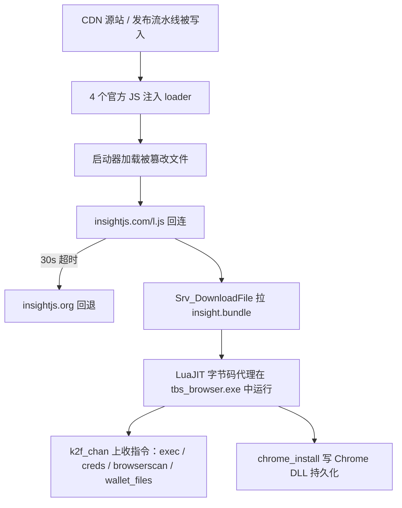

NIKKE 的 PC 启动器在 2026 年 9 月底被塞进了 loader，10 月 23 日起开始真的下发远控代理，直到 11 月 3 日厂商才换掉文件。这是近几年少见的、完整公开了攻击链与 IOC 的桌面客户端供应链事件，比「某 CDN 被黑」的标题更值得逐段拆开看：它把「官方来源即可信」「改了文件会被发现」「源站修好就安全」这三个默认假设一起打碎了。下面按攻击链、为何常见防护失效、开发者能做什么三段来写。所有结论来自公开报告与厂商声明，样本未做动态复现。

## 事件本身的形状

2026 年 10 月 23 日到 11 月 3 日，任何打开《胜利女神：新的希望》（NIKKE）PC 启动器的人，都可能在不知情的情况下装上一个远程控制代理。攻击面不在游戏本体，而在启动器从 Level Infinite 自家 CDN 上拉取的四份**官方 JavaScript 文件**：`aegis-fix.min.js`、`images.7fec4c32.js`、`FeedList.feb647c9.js`、`vue-bucket.min.js`。这些文件的 `last-modified` 停在 2026-09-27 06:41–06:42 GMT，注入的代码只是往页面里加一个 `<script>`，指向 `https://insightjs.com/l.js?f=aegis|images|feedlist|vue`，加载完立刻把自己摘掉。

这件事值得写，不是因为它「又是一起供应链攻击」，而是因为它把三个平时被当成可靠前提的假设同时打碎了：

- **「文件在官方 CDN 上就代表可信」** —— 攻击者拿到的是 CDN 源站或发布流水线的写权限，域名、证书、TLS 一个都没坏。
- **「改了文件会被发现」** —— 注入只加了 708 字节，且塞在 `export{...}` 之前，只比对文件尾部或只看 diff 首行的检查都会漏。
- **「源站修好了就安全了」** —— `FeedList.feb647c9.js` 在 10 月 28 日 15:46 GMT 就已在源站恢复干净，可边缘节点抱着 9 月 30 日、10 月 15 日的旧缓存继续发，直到 11 月 4 日 03:12–03:21 GMT 才被清掉。中间那约 155 小时，修完等于没修。

## 攻击链拆成四段



几个细节决定了它为什么难查：

1. **代理本体没有网络代码。** 它只加载 `kernel32`、`crypt32`、`bcrypt`、`gdiplus` 这些本地 DLL，所有上行流量都走启动器内嵌的浏览器进程 `tbs_browser.exe`。于是防火墙、代理日志、SRUM 的网络记录里看到的都是浏览器，不是游戏，也不是代理。
2. **预取与进程创建日志看不到。** 只有 `exec` 会 `CreateProcessW`，其余命令都在启动器进程内通过 LuaJIT FFI 完成——读凭据、扫 28 个浏览器钱包扩展、读 264 个凭据文件路径，全程不产生新进程。
3. **持久化伪装成 Chrome 的正常组件。** 恶意 DLL 落在 `%LOCALAPPDATA%\Google\Chrome\User Data\PlatformExperienceHelper\<64 位十六进制>\platform_experience_helper.dll`，并通过 `HKCU\Software\Classes\CLSID\{E77CC89B-...}` 让 Chrome 加载它。`PlatformExperienceHelper` 这个目录 Chrome 自己会建，所以「有个这个目录」完全正常，只有那个 64 位十六进制子目录和 DLL 才是恶意的。它还不需要 Chrome 已安装就能写进去。
4. **缓存里的证据是 gzip 的。** 启动器的 HTTP 缓存在 `tbs_cache\Cache\` 下按 gzip 原样落盘，明文 grep 搜 `insightjs` 一无所获；得先解压再搜 `String.fromCharCode(111,114,103)`——回退域名 `insightjs.org` 是用字符码拼出来的，文件里根本没有明文域名。

## 为什么 SRI 这类前端防护在这里失效

子资源完整性（SRI）的思路是：页面加载脚本时带上 `integrity=sha384-...`，浏览器自己算哈希，对不上就不执行。它确实能挡住「CDN 内容被换掉」这一类攻击，但有三个前提，这个场景一个都不成立：

- **SRI 只保护页面显式声明`integrity`的脚本。** 桌面启动器不是浏览器页面，它的 JS 桥、`Srv_DownloadFile` 这类能力都挂在宿主应用上，没有 HTML `<script>` 标签可写，也就没有 `integrity` 可用。
- **动态加载绕开静态校验。** 注入代码用 `new TextDecoder().decode(new Uint8Array(new Uint32Array([...]).buffer))` 把 URL 藏在整数数组里，再加 `<script>` 标签。即便应用侧做了「只允许已知域名」的字符串白名单，它也只看得到解码后的最终 URL。
- **同一份清单要覆盖全部入口。** 一个应用通常有几十个入口文件、多个环境（`na-webassets`、`sg-gpts`）、多套 CDN 服务器，SRI 需要每个入口都写对，而这次被改的恰好是「大家默认不会去改」的公共库。

对开发者而言更现实的一层是：**桌面客户端等于把浏览器的运行时和权限一起打包发给了用户**。Wine/Proton 下更糟——Wine 会把 Linux 家目录和 `/` 映射成盘符，环境变量也原样传进去。代理的 Windows 持久化在 Linux 上跑不起来，但 `exec`、`ls`、`cat`、`download` 照样能读 `~/.ssh`、浏览器配置、shell 历史里那些带 API key 的 export 语句。

## 第一步：把「构建产物」当成校验对象

SRI 在桌面端用不上，但它的核心思路可以搬：**校验的是线上真实字节，不是源码，也不是版本号**。构建流水线产出 `app.1a2b.js`，就把它的 SHA-256 记进清单；发布前、上线后各跑一次比对。

```js
// verify-asset.mjs —— 校验 CDN 上的可执行资产是否与构建清单一致
// 用法：node verify-asset.mjs manifest.json
// 清单：[{ "url": "...", "sha256": "<64 位小写十六进制>" }]
import { createHash } from 'node:crypto'
import { readFile } from 'node:fs/promises'

const TIMEOUT_MS = 15_000

async function fetchBytes(url) {
  const ctrl = new AbortController()
  const timer = setTimeout(() => ctrl.abort(), TIMEOUT_MS)
  try {
    // no-cache 让边缘回源，避免拿到还没清的旧副本
    const res = await fetch(url, {
      signal: ctrl.signal,
      headers: { 'user-agent': 'asset-audit/1.0', 'cache-control': 'no-cache' },
    })
    if (!res.ok) throw new Error(`HTTP ${res.status} ${res.statusText}`)
    return Buffer.from(await res.arrayBuffer())
  } finally {
    clearTimeout(timer)
  }
}

const sha256 = (buf) => createHash('sha256').update(buf).digest('hex')

const manifest = JSON.parse(await readFile(process.argv[2], 'utf8'))
let bad = 0
for (const { url, sha256: expected } of manifest) {
  try {
    const buf = await fetchBytes(url)
    const actual = sha256(buf)
    const ok = actual === expected.toLowerCase()
    console.log(`${ok ? 'OK  ' : 'FAIL'} ${buf.length}B ${actual} ${url}`)
    if (!ok) { bad++; console.error(`     期望 ${expected}\n     实际 ${actual}`) }
  } catch (err) {
    bad++
    console.error(`FAIL 抓取失败 ${url}: ${err.message}`)
  }
}
// 非零退出码可直接挂到 CI 或定时任务，失败即阻断发布或告警
if (bad > 0) { console.error(`\n${bad} 个资产不一致`); process.exit(1) }
console.log('\n全部一致')
```

关键在于**多服务器、多路径都要测**。这次事件里，43.152.43.115 那台边缘服务器早就拿到了干净副本，所以「抽查一台、通过」的结论是假的；同一路径的 `na-webassets` 和 `sg-gpts`、带不带 query string、gzip 与否，都得单独比。这类「只抽一台就算过」的习惯，[《复习GitHub并使用Actions自动化部署》]() 里那套 push 即部署的流程同样存在——它只保证文件搬到了远端，从不核对搬过去的是不是构建出来的那份。

同理，[《利用git+宝塔webhooks实现远程同步Linux服务器》]() 里的 webhook 拉起即生效的模式，也没有任何产物哈希核对环节；一旦中间某个环节能写文件，链路上没人会发现。

## 第二步：让用户能自证没中招

事后补救的上限是「知道该查什么」。厂商声明往往只有一句「可能被第三方篡改，已修复」，既不说文件名、也不给用户可执行的步骤——这次 Level Infinite 11 月 4 日的声明就是如此。所以客户端侧至少要提供两类自检：日志痕迹和缓存内容。

```python
#!/usr/bin/env python3
"""离线排查启动器是否被植入 loader / 远控代理（只读，不发网络请求）"""
import argparse, gzip, os, re, sys

# 回退域名 insightjs.org 由 String.fromCharCode 拼出，明文域名搜不到
SIG = b"String.fromCharCode(111,114,103)"
LOGS = (b"k2f_chan registered", b"lua downloaded to log\\tinyget")
STATE = b"k2f.agent.state"
DIRS = ("nikke_launcher", "nikke_launcher_hmt", "nikke_launcher_google")

def read_tail(path, limit=200 * 1024):
    with open(path, "rb") as f:              # 只读，别先删缓存再查
        f.seek(max(0, os.path.getsize(path) - limit))
        return f.read()

def scan_log(path):
    buf, hits = read_tail(path), []
    for hint in LOGS:
        if hint in buf:
            for line in buf.splitlines():
                if hint in line and line not in hits:
                    hits.append(line)
    # 日志里可能夹 token / cookie，对外发之前必须打码
    return [(path, re.sub(rb"[A-Za-z0-9_.-]{24,}", b"<redacted>", h)[:160]) for h in hits]

def scan_gzip(paths):
    """缓存按 gzip 原样落盘，明文 grep 必漏，必须先解压"""
    found = []
    for path in paths:
        try:
            if os.path.getsize(path) > 8 * 1024 * 1024:
                continue
            buf = read_tail(path, 8 * 1024 * 1024)
            start = buf.find(b"\x1f\x8b\x08")     # gzip 魔数，前面可能是 HTTP 头
            if start < 0:
                continue
            if SIG in gzip.decompress(buf[start:]):
                found.append(path)
        except (OSError, EOFError):
            continue                              # 尾部块头残留解压失败就跳过
    return found

def main():
    ap = argparse.ArgumentParser()
    ap.add_argument("--prefix", help="Wine/Proton 前缀")
    ap.add_argument("--appdata", help="启动器数据目录")
    args = ap.parse_args()

    roots = [args.appdata] if args.appdata else []
    if args.prefix:
        base = os.path.join(args.prefix, "drive_c", "users")
        if os.path.isdir(base):
            roots += [os.path.join(base, u, "AppData", "Roaming") for u in os.listdir(base)]
    if not roots:
        ap.error("至少给一个 --prefix 或 --appdata")

    log, state, cache = [], [], []
    for root in roots:
        for d in DIRS:
            base = os.path.join(root, d)
            if not os.path.isdir(base):
                continue
            for rel in ("Launcher/intl_service/debug.log", "intl_service/debug.log"):
                if os.path.isfile(os.path.join(base, rel)):
                    log += scan_log(os.path.join(base, rel))
            ls = os.path.join(base, "tbs_cache", "Local Storage", "leveldb")
            if os.path.isdir(ls):
                state += [os.path.join(ls, n) for n in os.listdir(ls)
                          if os.path.isfile(os.path.join(ls, n))
                          and STATE in read_tail(os.path.join(ls, n))]
            cdir = os.path.join(base, "tbs_cache", "Cache")
            if os.path.isdir(cdir):
                cache += scan_gzip([os.path.join(cdir, n) for n in os.listdir(cdir)])

    for name, items in (("log", log), ("state", state), ("cache", cache)):
        print(f"{name:6s} {len(items)} 条")
        for item in items[:5]:
            print("   ", item)
    print("\n结论：" + ("命中感染痕迹" if (log or state or cache) else "未发现痕迹（缓存已删则无法回溯）"))
    return 1 if (log or state or cache) else 0

if __name__ == "__main__":
    sys.exit(main())
```

三个顺序上的细节，都是踩过的坑：

- **先查再删缓存。** `tbs_cache` 里既有被篡改的 JS（下次打开还会被加载），也有 `k2f.agent.state` 这种「代理跑来过」的证据。先删就等于把证据和隐患一起扔了，顺序必须是「查完 → 备份 → 删」。
- **不要用杀毒软件结果当结论。** 微软 Defender 离线扫描在样本机上没能识别那个 DLL；反过来说，查毒干净也不等于没中招。
- **别把整目录当特征。** `PlatformExperienceHelper` 目录本身是 Chrome 正常创建的，删掉它既没用也会误伤；特征是那个 64 位十六进制子目录里的 DLL。

## 处置清单：按「能立刻被利用」排序

中了就按暴露程度排序，而不是按「哪个顺手」：

1. **先断网或关掉启动器**，切断操作员通道。代理只在启动器打开期间活着，但它能 `exec`，可以自己留下计划任务。
2. **清持久化**：删 `HKCU\Software\Classes\CLSID\{E77CC89B-7401-4C04-8CED-149DB35ADD04}`，**重启**（DLL 被加载期间锁着，关掉所有 Chrome 窗口也没用），再删 `PlatformExperienceHelper` 下的 64 位十六进制子目录。HKLM 下同名 CLSID 是系统的，别动。
3. **换密码、登出会话**：NIKKE 账号优先，然后邮箱、Discord、银行，再是所有存在浏览器里的密码。Cookie 不需要密码就能用，所以「登出所有设备」和「改密码」两件事都得做。
4. **吊销令牌**：GitHub、npm、AWS、OpenAI、Anthropic 这些；以及 `~/.ssh` 里的密钥。代理的 `keyscan` 明确覆盖了 AWS/Azure/GCP、K8s、Terraform、Docker、Hugging Face，还有 `~/.claude/.credentials.json`、`$CODEX_HOME/auth.json`、Gemini CLI 的 `oauth_creds.json` 这类 AI 工具凭据——开发者机器上这些往往比密码更值钱。
5. **换钱包助记词**：28 个浏览器钱包扩展是明确目标，只有把资金转到新助记词的钱包才算数。
6. **最保险的是重装系统**，因为 `exec` 意味着对方在你的权限下做过什么，从日志上是看不出来的——代理的所有命令都不写启动器日志。

## 结论

这次事件的教训不是「腾讯 CDN 不安全」，而是一个更普遍的结构问题：**我们习惯用「文件从哪来」来判断可不可信，但攻击者恰好能改「文件从哪来」的最后一公里**。能对抗这件事的只有两样东西——对线上真实字节的哈希校验，以及把「怀疑」变成用户自己能跑的自检。前者要在流水线里常态化（多服务器、多路径、多环境，不能抽一台就算过），后者要在出事前就交付到客户端里，而不是等出事后再发一条「已修复」的公告。

至于那个修正本身，也提醒了一句：源站改完不等于生效完成。缓存过期时间写着 `max-age=7776000`（90 天）的时候，一次「已修复」发布的实际生效时间，取决于最后一台还没刷新的边缘节点。

来源：[MotherSphere 的事件报告（含完整 IOC 与处置清单）](https://gist.github.com/MotherSphere/d6c049a09ba8ac3085c51ee9df24a4e5)，[Solidot 报道](https://www.solidot.org/story?sid=85798)，[NIKKE Launcher Check 检查工具](https://github.com/MotherSphere/NIKKE-Launcher-Check)。
