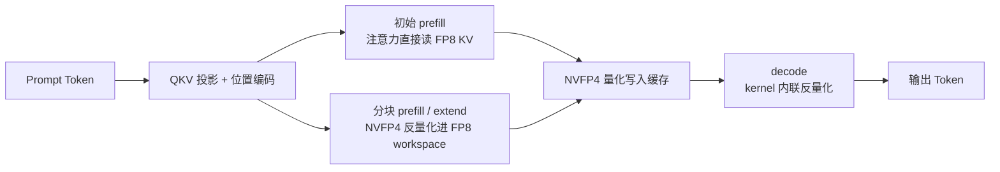
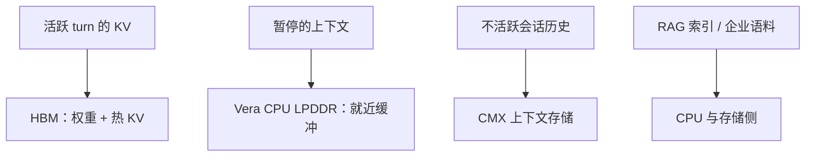

英伟达在 11 月 5 日发布的技术解读里有一组很容易被划过去的对比：Vera Rubin NVL72 相比 GB300 NVL72，每个 GPU 的 HBM 容量只增加约 3%，但在每用户每秒 125 token 的条件下，[每美元智能体吞吐量最高提升 30 倍](https://www.ithome.com/1/023/025.htm)。HBM 只多了 3%，吞吐涨了 30 倍——剩下那 29 倍，显然不是显存堆出来的。

这组数字其实宣告了一个方向变化：AI 基础设施的竞争点，正在从「一张卡有多少显存」转向「每一字节、每一瓦特能产出多少有效 token」。对写推理服务的工程师来说，这句话可以直接翻译成三条可操作的命题：KV 缓存才是显存的主增长项；4 bit 量化省下的不是数字而是**驻留能力**；而驻留能力只有转化成 cache hit rate 才值钱。

下面按这个顺序拆：先把显存账算清楚，再看 NVFP4 的两级缩放为什么能在 4 bit 上站住，然后是它在 SGLang 里的三条数据流，最后是实测数据该怎么读、以及落地时要盯哪些指标。

## 一、先把账算清楚：模型权重是常数，KV 才是变量

同一个模型，权重占的显存是固定的；KV 缓存则是 `batch × seq_len × 层数 × KV head 数 × head_dim × 字节数`，其中 `seq_len` 和 `batch` 都可以无上限地涨。智能体工作流尤其坏：它在多次模型调用、工具调用之间不断携带历史上下文，[部分场景要处理多达 300 万个 token](https://www.ithome.com/1/023/025.htm)，而且每一轮只追加、不释放。

下面这段脚本只依赖标准库，把「一个 token 吃多少显存、一块卡装得下几个会话」算成具体数字。注意 NVFP4 的字节数是 `9/16`：16 个 E2M1 值打包成 8 字节，外加 1 字节的 E4M3 block scale，所以每个数值平均 0.5625 字节，正好是 FP8 的 56%。

```python
#!/usr/bin/env python3
"""估算 KV 缓存占用：每个 token 占多少显存，一块卡能驻留几个会话。"""

BYTES_PER_VALUE = {
    "bf16": 2.0,       # 主流基线
    "fp8": 1.0,        # E4M3，最常见的 KV 量化格式
    "nvfp4": 9 / 16,   # 每 16 个值打包成 8 字节 + 1 字节 block scale
}

LAYERS = 80        # 层数
KV_HEADS = 8       # GQA 的 KV head 数（不是 attention head 数）
HEAD_DIM = 128     # 每个 head 的维度
GPU_MEM_GB = 96.0  # 单卡 HBM
STATIC_FRAC = 0.9  # 静态显存占比上限，留 10% 给 workspace 与临时缓冲

encode = lambda gb: gb * 1024 ** 3          # GB → 字节
for dtype, b in BYTES_PER_VALUE.items():
    # K 和 V 都要存，所以乘 2；每个 token 每层每个 KV head 有 head_dim 个元素
    per_token = 2 * LAYERS * KV_HEADS * HEAD_DIM * b
    budget = encode(GPU_MEM_GB) * STATIC_FRAC
    ctx = 128 * 1024                          # 单个会话 128K 上下文
    print(f"{dtype:5s} 每 token {per_token / 1024:7.1f} KB  "
          f"128K 会话占 {per_token * ctx / 2**30:6.1f} GB  "
          f"单卡可驻留 {int(budget // (per_token * ctx))} 个")

# 跨卡视角：3M token 的智能体上下文，一张 96GB 卡装不下，必须按 TP 切分
tokens = 3_000_000
for dtype in ("fp8", "nvfp4"):
    per_token = 2 * LAYERS * KV_HEADS * HEAD_DIM * BYTES_PER_VALUE[dtype]
    total = per_token * tokens / 2**30
    print(f"{dtype:5s} 3M token 单会话需要 {total:6.0f} GB，"
          f"即 {int(-(-total // (GPU_MEM_GB * STATIC_FRAC)))} 张 "
          f"{GPU_MEM_GB:.0f}GB 卡才装得下")
```

按 80 层、8 个 KV head、head_dim 128 的口径跑出来是这样：

```text
bf16  每 token   320.0 KB  128K 会话占   40.0 GB  单卡可驻留 2 个
fp8   每 token   160.0 KB  128K 会话占   20.0 GB  单卡可驻留 4 个
nvfp4 每 token    90.0 KB  128K 会话占   11.2 GB  单卡可驻留 7 个
fp8   3M token 单会话需要    458 GB，即 6 张 96GB 卡才装得下
nvfp4 3M token 单会话需要    257 GB，即 3 张 96GB 卡才装得下
```

两件事立刻显形：**128K 上下文下，BF16 到 NVFP4 把单卡驻留会话数从 2 个拉到 7 个**；而 300 万 token 的极端智能体上下文，FP8 要 6 张卡、NVFP4 只要 3 张。同样一块显存，FP8 → NVFP4 的容量比是 `1.0 / 0.5625 = 1.78` 倍，BF16 → NVFP4 是 3.56 倍——和 [LMSYS 那篇 NVFP4 KV 实践](https://www.lmsys.org/blog/2026-09-16-nvfp4-kv-cache) 给的理想值一致。但他们同时提醒：算上 workspace、内存池和全局 scale 元数据，**实际可用容量低于这个上限**，规划时按 1.5~1.7 倍来，别把 1.78 直接写进容量表。

这里顺手把层的归属说清楚：应用层的会话记忆和推理层的 KV 缓存是两回事。前者是 Redis 里的消息数组和摘要，后者是 GPU 上按 token 索引的 K/V 张量。如果你的 Agent 已经在用 Redis 做会话记忆，可以对照 [《用 Redis 承载 Agent 会话记忆：存储边界、压缩时机与并发写入》]() 划清这两层的边界，别把「省显存」的期待压在应用层缓存上——那一层管的是消息存多久，这一层管的是一个 token 能不能留在 HBM 里。

## 二、NVFP4 省在哪：两级缩放是 4 bit 能用的前提

把 KV 从 BF16 压到 FP8 已经被广泛采用，再往 4 bit 走，量化误差会明显放大。NVFP4 的做法是**用两层 scale 换精度**：

- 数据位：4 bit 的 E2M1，只表示 `±{0, 0.5, 1, 1.5, 2, 3, 4, 6}` 这 16 个值；
- 块内缩放：每 16 个连续值共享一个 FP8（E4M3）的 scale；
- 全局缩放：整个 tensor 再乘一个 FP32 的 scale。

E2M1 本身的动态范围极窄（最大 6），如果只有一个全局 scale，一个巨大的离群值就会把所有小值压到同一个量化台阶上。block scale 把「局部动态范围」交给每个 16 元素的小块，全局 scale 只兜底，误差就被限制在块内。块大小取 16 也不是随手选的：它和 Blackwell 上 MMA 的 scale 粒度对齐。

下面这段代码只依赖标准库，用「每块 amax 映射到 6」的方式复刻这套逻辑，把「仅全局 scale」和「块内 + 全局」的误差放在一起对比。它跑的是真实的分块量化流程，不是伪代码：

```python
"""纯标准库复刻 NVFP4 的两级缩放，对比块内 scale 与仅全局 scale 的误差。"""
import random
import statistics

# E2M1 能表示的全部 16 个值（4 bit 编码顺序不重要，这里按数值排列）
E2M1 = [-6.0, -4.0, -3.0, -2.0, -1.5, -1.0, -0.5, -0.0,
        0.0, 0.5, 1.0, 1.5, 2.0, 3.0, 4.0, 6.0]
E2M1_MAX = 6.0
BLOCK = 16  # 每个 block 共享一个 FP8 scale，与 Blackwell 的 MMA 粒度对齐


def snap(x):
    """把 x 吸附到 E2M1 里最近的可表示值。"""
    return min(E2M1, key=lambda v: abs(v - x))


def quant_blocks(values, block=BLOCK):
    """NVFP4：每 block 一个 scale，块内再乘全局 scale。"""
    out = []
    for i in range(0, len(values), block):
        chunk = values[i:i + block]
        amax = max(abs(v) for v in chunk)
        scale = amax / E2M1_MAX if amax > 1e-12 else 1.0
        out.extend(snap(v / scale) * scale for v in chunk)
    return out


def quant_global(values):
    """只有一个全局 scale，模拟把 4 bit 直接当全局量化的坏情况。"""
    amax = max(abs(v) for v in values)
    scale = amax / E2M1_MAX if amax > 1e-12 else 1.0
    return [snap(v / scale) * scale for v in values]


def rmse(orig, deq):
    return statistics.fmean((a - b) ** 2 for a, b in zip(orig, deq)) ** 0.5


if __name__ == "__main__":
    random.seed(20261106)
    # 模拟一层 KV：绝大部分值很小，8 个离群值——真实 KV 分布就长这样
    values = [random.gauss(0, 0.02) for _ in range(4096)]
    for _ in range(8):
        values[random.randrange(len(values))] = 6.0

    print(f"块内 + 全局缩放 RMSE: {rmse(values, quant_blocks(values)):.6f}")
    print(f"仅全局缩放       RMSE: {rmse(values, quant_global(values)):.6f}")
```

在同一份「大部分值约 0.02、8 个离群值 6.0」的模拟数据上，两种做法的误差差了一个量级：

```text
块内 + 全局缩放 RMSE: 0.003412
仅全局缩放       RMSE: 0.019623
```

5.8 倍的差距说明了一件事：4 bit 能不能用，从来不取决于位数，而取决于**是否给局部动态范围留了出口**。这也解释了一个容易忽略的细节——LMSYS 的实验里**没有启用 NVFP4 的 per-tensor FP32 全局 scale（直接取 1.0）**，他们自己在局限说明里写了「正确校准可以减小数值溢出/下溢，可能进一步收窄与 FP8 KV 的精度差」。也就是说，现在公开的 4 bit KV 精度数据，是没做过全局校准的版本，属于偏保守的下限。

## 三、三条数据流：NVFP4 KV 在 SGLang 里怎么跑

LMSYS、Qwen、NVIDIA 三方联合的实现在 SGLang 的分页 KV 缓存上接了三类注意力路径，每类的数据流都不一样：



三个关键点值得单独拎出来，因为它们决定了这套方案为什么不会「越量化越慢」：

1. **初始 prefill 直接吃 FP8，不吃缓存。** 当前 prompt 的 K/V 先以 FP8 参与注意力计算，同时被量化写成 NVFP4 供后续使用。省下的那次反量化，正好落在最吃算力的阶段。
2. **分块 prefill / extend 把 NVFP4 反量化到一份跨层复用的 FP8 workspace。** 注意是「跨层复用同一对 buffer」，而不是每层各开一份 FP8 工作区——否则省下来的显存又被 workspace 吃回去。
3. **decode 在 kernel 内部就地反量化，不做独立的 dequant 算子。** 这是最关键的一处。decode 阶段的 query 很短、KV 极长，注意力性能完全由 KV 读取带宽决定；如果先把整个 KV 缓存反量化写回显存再算，等于多出一次全量读写，反而比 FP8 更慢。实现里用 `cvt.rn.bf16x2.e2m1x2` 指令把成对的 E2M1 就地转成 BF16，block scale 也在寄存器里应用，全程不多走一次显存往返。

也正因为如此，收益全在 decode 侧，prefill 侧基本没有——这一点直接决定了下面数据该怎么读。

## 四、实测数据的正确读法：两个对比口径不能混

公开数据里有两组容易混为一谈的基准，混了就会得出错误的容量规划：

**等并发（iso-concurrency）**：把 decode 侧实际并发数按住不变，只换 KV 格式。32K / 160K / 1M 三个输入长度下，NVFP4 的峰值 batch decode 吞吐提升约 26%~30%。这部分纯粹来自 KV 读取流量减少。

**等容量（iso-capacity）**：放开并发，让 NVFP4 多吃它多出来的那些 KV 槽位。同一张卡上，32K 场景的驻留请求从 44 涨到 70，160K 从 10 涨到 15，1M 从 1 涨到 2；峰值吞吐分别提升 37.37%、57.75%、78.46%。

差值就是「容量红利」：26% 是量化的直接收益，剩下的 11~48 个百分点，是把省下来的显存换成了并发。**如果你的服务本来就没打满显存，第一组数字才是你的真实收益；第二组属于「压着容量跑」的场景。**

精度侧的代价要按任务看，不能用平均值糊过去。Qwen3.5-397B-A17B 上几乎无损（GSM8K 少对 1 题，约 0.08 个百分点）；Qwen3.8-27B 上 GSM8K 低 0.31 个百分点、GPQA-Diamond 低 1.01 个百分点，而 SWE-bench Verified 从 77.80% 掉到 76.20%，差 1.60 个百分点。规模越大、任务越偏「长上下文里做检索和推理」，对 4 bit 越不敏感——但样本只有两个模型，别把这条当成规律写进技术选型文档。

真正给决策定调的是智能体场景那一组：AgentX 基准在 8 卡 RTX 6000D、TP8、1200 秒窗口下，并发 ≤8 时 NVFP4 与 FP8 性能基本持平；并发超过 12 后 FP8 的吞吐和交互性断崖式下跌，NVFP4 还在继续爬。原因不是算力，而是**命中率**：高并发下 FP8 的 KV 缓存被逐出，命中率明显低于 NVFP4。

这就是全篇的核心结论：量化省下来的容量，只有在「原本会被逐出的前缀现在留住了」时才变成钱。对于上下文动辄几十万 token 的智能体，被逐出的代价不是少一次命中，而是要把整段前缀重新 prefill 一遍——那是实打实的首 token 延迟和算力空转。

## 五、分层放置：每一字节该待在哪一层

NVFP4 只是整个「全栈协同设计」里的一环。英伟达把这套思路概括为「把数据压缩、放在合适的层级、并在需要前提前送回 GPU」，具体落到五个位置：

| 层级 | 放什么 | 为什么 |
|---|---|---|
| HBM | 模型权重、当前活跃 turn 的 KV | 带宽最高，只留给真正在算的数据 |
| 多卡分片 | 权重切到最多 72 颗 GPU（NVL72） | 单卡装不下的模型靠切分而不是靠压缩 |
| Vera CPU 的 LPDDR | 暂停的上下文 | 大容量、就近，取回延迟可接受 |
| CMX 上下文存储 | 不活跃的历史上下文 | 由 Dynamo 迁移进出，复用前取回 |
| CPU / 存储侧 | RAG 索引、企业知识库 | 检索本来就发生在 CPU，别长期占 HBM |



这张表的价值在于它给了一个判断顺序：先问「这份数据下次被读到的概率有多高」，再问「它现在待的层级是不是最贵的那一层」。HBM 该被当成 L1 而不是仓库——容量再大，如果数据进出速度跟不上，新增容量也变不成服务能力。英伟达自己用了「仓库与装卸口」的比喻，说的就是这件事：带宽才是那个真正的瓶颈。

## 六、落地清单

如果你准备在自己的推理服务上试 4 bit KV，按这个顺序推进，能避开大部分坑：

1. **先量命中率，再决定要不要量化。** 用现有监控跑一遍 KV cache hit rate 和逐出次数。命中率本来就接近 100% 的服务，NVFP4 只会给你 26% 的带宽收益和高精度风险，容量红利是零。
2. **只压 KV，不动权重。** 上面的实现里模型权重始终是 FP8，`--kv-cache-dtype nvfp4` 单独控制 KV 格式。两者解耦，回滚成本才低。
3. **校准全局 scale。** 公开实验用的是 1.0，上生产至少跑一次基于真实流量分布的 amax 统计，这也是把 GPQA 那 1 个百分点的差距收窄的最便宜手段。
4. **精度回归按任务挑，别只跑通用集。** 长上下文检索、SWE-bench 这类任务对 KV 精度更敏感，通用集看不出问题不代表没问题。
5. **别把 decode 加速当端到端加速。** 超长 prompt 场景下 prefill 可能主导总耗时，decode 快一倍也不代表用户等待时间减半；同时注意 NVFP4 下 TTFT 在等并发时还有 0.2%~0.4% 的反向开销（量化和反量化的固定成本）。
6. **和层级缓存一起上，而不是二选一。** 一个负责扩大缓存层级（HiCache 之类），一个负责压缩每 token 的体积，两者互补：先压体积，再谈分层，收益叠乘。

最后一个提醒：SGLang 里的 NVFP4 KV 目前是**实验性支持**，架构上限在 SM12x 与 SM100/SM103，模型上支持 GQA 和 Sparse MLA。上生产前先确认卡型和模型结构在支持列表里，别拿一张 H100 去试一个只在 Blackwell 上有 kernel 的格式。

---

参考：NVIDIA [Five Ways Co-Design Maximizes the Value of Every Byte](https://developer.nvidia.com/blog/five-ways-nvidia-co-design-maximizes-the-value-of-every-byte-in-the-ai-factory/)、LMSYS [Accelerating Long-Context and Agentic Inference with NVFP4 KV Cache](https://www.lmsys.org/blog/2026-09-16-nvfp4-kv-cache)、SemiAnalysis [Rubin NVL72 Agentic Inference](https://newsletter.semianalysis.com/p/vera-rubin-nvl72-agentic-inference)、IT之家[原报道](https://www.ithome.com/1/023/025.htm)。
</content>
